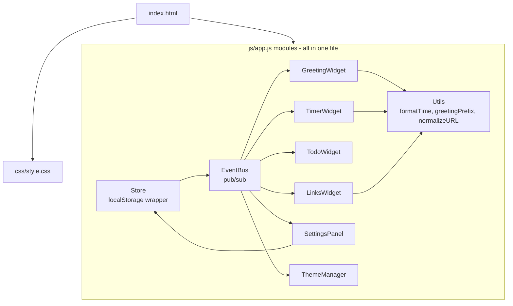
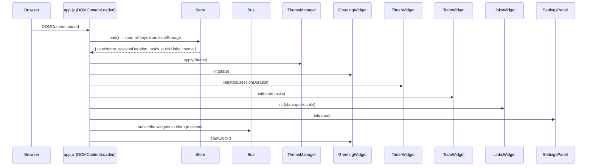

# Design Document

## Overview

The personal dashboard is a self-contained single-page web application delivered as three files: `index.html`, `css/style.css`, and `js/app.js`. It runs entirely in the browser with no build step, no framework, and no network requests after the initial page load. All state is held in browser `localStorage`.

The page is composed of four independent widgets — Greeting, Timer, Todo, and Links — plus a Settings panel. Each widget manages its own DOM subtree and reacts to shared state changes via a lightweight publish/subscribe bus. The Settings panel writes values to `localStorage` and fires change events; widgets subscribe and re-render their relevant slice of state.

The architecture deliberately keeps the surface area small: one HTML file for markup structure, one CSS file for all visual rules (including theme variables), and one JavaScript file for all logic. No external fonts, stylesheets, or scripts are fetched.

---

## Architecture



### Initialization sequence



---

## Components and Interfaces

All components are plain objects (or classes) instantiated once. They communicate through the `EventBus` and do not hold references to each other.

### Store

Wraps `localStorage` reads and writes. Catches all `DOMException` errors and surfaces them without throwing.

```
Store.get(key: string) → any | null
Store.set(key: string, value: any) → { ok: boolean, error?: string }
Store.remove(key: string) → void
Store.loadAll() → AppState
```

`loadAll()` reads the five persisted keys (`userName`, `sessionDuration`, `tasks`, `quickLinks`, `theme`), validates each, and returns a fully-formed `AppState` with defaults for any missing or malformed values. Validation errors produce a warning via `Bus.emit('storageWarning', message)`.

### EventBus

```
Bus.on(event: string, handler: Function) → void
Bus.off(event: string, handler: Function) → void
Bus.emit(event: string, payload?: any) → void
```

Events emitted:

| Event | Payload | Emitted by |
|---|---|---|
| `themeChanged` | `'light' \| 'dark'` | SettingsPanel |
| `userNameChanged` | `string \| null` | SettingsPanel |
| `sessionDurationChanged` | `number` | SettingsPanel |
| `tasksChanged` | `Task[]` | TodoWidget |
| `linksChanged` | `Link[]` | LinksWidget |
| `storageWarning` | `string` | Store |
| `timerStateChanged` | `TimerState` | TimerWidget |

### GreetingWidget

Owns the `#greeting` DOM section. Holds a `setInterval` reference for the clock.

```
GreetingWidget.init(state: AppState) → void
GreetingWidget.startClock() → void   // sets 1-second interval, updates on minute boundary
GreetingWidget.render(now: Date, userName: string | null) → void
```

No external calls; uses `Utils.formatTime`, `Utils.formatDate`, `Utils.greetingPrefix`.

### TimerWidget

Owns the `#timer` DOM section. Internally tracks `remainingSeconds`, `isRunning`, and `intervalId`.

```
TimerWidget.init(sessionDuration: number) → void
TimerWidget.start() → void
TimerWidget.stop() → void
TimerWidget.reset() → void
TimerWidget.render() → void
TimerWidget.playAlert() → void   // Web Audio API oscillator, 1-3 s
```

Subscribes to `sessionDurationChanged`. When the event fires:
- If stopped: resets to new duration immediately.
- If running or paused: stores the new duration for the next session without touching `remainingSeconds`.

### TodoWidget

Owns the `#todo` DOM section. Holds the canonical `tasks: Task[]` array in memory and syncs it to `Store` on every mutation.

```
TodoWidget.init(tasks: Task[]) → void
TodoWidget.addTask(description: string) → void
TodoWidget.toggleTask(id: string) → void
TodoWidget.deleteTask(id: string) → void
TodoWidget.startEdit(id: string) → void
TodoWidget.saveEdit(id: string, description: string) → void
TodoWidget.render() → void
```

Task IDs are generated with `crypto.randomUUID()` (available in all modern browsers without a flag).

### LinksWidget

Owns the `#links` DOM section. Holds the canonical `links: Link[]` array in memory and syncs it to `Store` on every mutation.

```
LinksWidget.init(links: Link[]) → void
LinksWidget.addLink(label: string, url: string) → void
LinksWidget.deleteLink(id: string) → void
LinksWidget.render() → void
```

URL normalization (`Utils.normalizeURL`) is applied before storing.

### SettingsPanel

Owns the `#settings` DOM section.

```
SettingsPanel.init(state: AppState) → void
SettingsPanel.saveName(raw: string) → void
SettingsPanel.saveDuration(raw: string) → void
SettingsPanel.toggleTheme() → void
SettingsPanel.showError(field: string, message: string) → void
SettingsPanel.clearError(field: string) → void
```

Validates inputs before writing to `Store` and emitting events.

### ThemeManager

```
ThemeManager.apply(theme: 'light' | 'dark') → void
```

Sets `document.documentElement.dataset.theme` to `'light'` or `'dark'`. CSS rules bind to `[data-theme='dark']` to switch the custom-property palette. No DOM rebuild required; the change propagates via CSS cascade within 100 ms.

### Utils

Pure functions with no side effects.

```
Utils.formatTime(date: Date) → string          // "HH:MM" 24-hour
Utils.formatDate(date: Date) → string          // "Weekday, DD Month YYYY"
Utils.greetingPrefix(hour: number) → string    // "Good morning" | ...
Utils.formatCountdown(seconds: number) → string // "MM:SS"
Utils.normalizeURL(raw: string) → string       // prepends https:// if no scheme
Utils.isValidURL(raw: string) → boolean
```

---

## Data Models

### AppState (runtime)

```js
{
  userName: string | null,       // null if not set
  sessionDuration: number,       // minutes, 1–120, default 25
  tasks: Task[],
  quickLinks: Link[],
  theme: 'light' | 'dark'        // default 'light'
}
```

### Task

```js
{
  id: string,          // crypto.randomUUID()
  description: string, // 1–200 chars
  completed: boolean
}
```

### Link

```js
{
  id: string,          // crypto.randomUUID()
  label: string,       // 1–50 chars
  url: string          // normalized, begins with http:// or https://
}
```

### LocalStorage layout

| Key | Type | Default if absent |
|---|---|---|
| `userName` | `string` | `null` (key absent) |
| `sessionDuration` | `string` (numeric) | `"25"` |
| `tasks` | JSON array of Task | `[]` |
| `quickLinks` | JSON array of Link | `[]` |
| `theme` | `"light"` \| `"dark"` | `"light"` |

Primitive values (`userName`, `sessionDuration`, `theme`) are stored with `localStorage.setItem(key, String(value))`. Arrays are stored with `JSON.stringify`. On read, arrays are parsed with `JSON.parse`; if parsing throws or the result is not an array, the Store returns `[]` and emits a `storageWarning`.

### TimerState (runtime only, not persisted)

```js
{
  remainingSeconds: number,
  isRunning: boolean,
  isPaused: boolean
}
```

---

## Correctness Properties

*A property is a characteristic or behavior that should hold true across all valid executions of a system — essentially, a formal statement about what the system should do. Properties serve as the bridge between human-readable specifications and machine-verifiable correctness guarantees.*

### Property 1: Greeting prefix covers all 24 hours without gaps or overlaps

*For any* integer hour in the range [0, 23], `Utils.greetingPrefix(hour)` SHALL return exactly one of "Good morning", "Good afternoon", "Good evening", or "Good night", and no two adjacent hours spanning a boundary shall return conflicting values.

**Validates: Requirements 1.3, 1.4, 1.5, 1.6**

---

### Property 2: LocalStorage JSON round-trip preserves task array

*For any* array of Task objects with valid fields, serializing the array with `JSON.stringify` and then parsing the result with `JSON.parse` SHALL produce an array semantically equivalent to the original (same length, same field values for each element).

**Validates: Requirements 8.2, 8.5**

---

### Property 3: LocalStorage JSON round-trip preserves link array

*For any* array of Link objects with valid fields, serializing the array with `JSON.stringify` and then parsing the result with `JSON.parse` SHALL produce an array semantically equivalent to the original (same length, same field values for each element).

**Validates: Requirements 8.3, 8.5**

---

### Property 4: URL normalization is idempotent

*For any* URL string, applying `Utils.normalizeURL` twice SHALL produce the same result as applying it once — that is, an already-normalized URL is unchanged by a second normalization pass.

**Validates: Requirements 6.4**

---

### Property 5: Empty-task rejection preserves list length

*For any* task list and any string composed entirely of whitespace (including the empty string), calling `TodoWidget.addTask` with that string SHALL leave the task list length unchanged.

**Validates: Requirements 5.3**

---

### Property 6: Task addition grows the list by exactly one

*For any* task list and any valid task description (non-empty, 1–200 characters, not purely whitespace), calling `TodoWidget.addTask` SHALL increase the task list length by exactly one and the new task SHALL appear in the list with `completed: false`.

**Validates: Requirements 5.2**

---

### Property 7: Countdown display format is always MM:SS

*For any* integer number of seconds in the range [0, 7200] (the maximum timer duration of 120 minutes), `Utils.formatCountdown(seconds)` SHALL return a string matching the pattern `^\d{2}:\d{2}$` with the minutes and seconds values correct.

**Validates: Requirements 3.1**

---

### Property 8: Link addition grows the list by exactly one (up to the maximum)

*For any* link list with fewer than 20 entries and any valid label/URL pair, calling `LinksWidget.addLink` SHALL increase the link list length by exactly one.

**Validates: Requirements 6.2, 6.8**

---

### Property 9: Maximum-link enforcement prevents overflow

*For any* link list that already contains exactly 20 entries, calling `LinksWidget.addLink` with any valid label/URL pair SHALL leave the link list length unchanged at 20.

**Validates: Requirements 6.8, 6.9**

---

## Error Handling

### LocalStorage unavailable on read

`Store.loadAll()` wraps every `localStorage.getItem` call in a try/catch. If `localStorage` is inaccessible (e.g., private-browsing restriction), `loadAll()` returns a full `AppState` populated with defaults and emits a `storageWarning` event. The UI renders normally; a non-blocking banner is shown at the top of the page.

### LocalStorage write failure

`Store.set()` catches `DOMException` on `setItem`. On failure it returns `{ ok: false, error: message }`. The calling widget retains its in-memory state unchanged (the last successfully persisted state is unmodified) and displays a non-blocking warning notification. The failed write is not retried automatically.

### Malformed JSON in LocalStorage

If `JSON.parse` throws when reading `tasks` or `quickLinks`, `Store.loadAll()` treats the key as absent, returns an empty array for that widget, and emits a `storageWarning`.

### Invalid theme value in LocalStorage

If the stored `theme` value is not `"light"` or `"dark"`, `ThemeManager.apply` defaults to `"light"`.

### Invalid sessionDuration in LocalStorage

If the stored value is not a whole number in [1, 120], `Store.loadAll()` defaults to 25.

### Settings validation errors

`SettingsPanel` validates all inputs client-side before calling `Store.set`:
- Name > 50 chars: displays inline error, does not write.
- Session duration outside [1, 120]: displays inline error with the valid range, does not write.
- Link label empty or URL empty: displays an adjacent inline error per field, does not add the link.

### Timer edge cases

- `TimerWidget.start()` is a no-op when `remainingSeconds === 0`.
- `TimerWidget.reset()` calls `clearInterval` before updating state to prevent double-tick artefacts.

### URL validation

`LinksWidget.addLink` calls `Utils.isValidURL` after normalization. If the URL is longer than 2048 characters, the link is rejected with an inline error.

---

## Testing Strategy

### Unit tests (example-based)

Implemented with **Vitest** (or the native browser test runner). Focus on specific examples and edge cases:

- `Utils.greetingPrefix`: one test per boundary hour (0, 5, 12, 18, 21, 23).
- `Utils.formatTime` / `Utils.formatDate` / `Utils.formatCountdown`: representative inputs including midnight, noon, zero seconds, 7200 seconds.
- `Utils.normalizeURL`: inputs already prefixed with `http://`, `https://`, no scheme, `ftp://` (no normalization applied).
- `Store`: mock `localStorage` with a stub; test get/set/remove, JSON parse failure, write failure.
- `SettingsPanel` validators: name at 50 chars (valid), 51 chars (invalid), empty; duration at 1, 120, 0, 121.
- `TodoWidget`: add task at 200 chars (valid), 201 chars (invalid), edit with empty string (retains original).
- `LinksWidget`: add 20th link (succeeds), add 21st link (rejected), delete link.

### Property-based tests

Implemented with **[fast-check](https://fast-check.dev/)** running in a Node.js environment (no browser required for pure-function properties). Each test runs a minimum of 100 iterations.

| Property | fast-check arbitraries |
|---|---|
| Property 1: Greeting prefix covers all hours | `fc.integer({ min: 0, max: 23 })` |
| Property 2: Task array round-trip | `fc.array(fc.record({ id: fc.uuid(), description: fc.string({ minLength: 1, maxLength: 200 }), completed: fc.boolean() }))` |
| Property 3: Link array round-trip | `fc.array(fc.record({ id: fc.uuid(), label: fc.string({ minLength: 1, maxLength: 50 }), url: fc.webUrl() }))` |
| Property 4: URL normalization idempotent | `fc.string()` |
| Property 5: Empty-task rejection | `fc.array(validTask()), fc.string().filter(s => s.trim() === '')` |
| Property 6: Task addition grows list | `fc.array(validTask()), fc.string({ minLength: 1, maxLength: 200 }).filter(s => s.trim().length > 0)` |
| Property 7: Countdown format | `fc.integer({ min: 0, max: 7200 })` |
| Property 8: Link addition grows list (< 20) | `fc.array(validLink(), { maxLength: 19 }), validLabelAndURL()` |
| Property 9: Max-link enforcement | `fc.array(validLink(), { minLength: 20, maxLength: 20 }), validLabelAndURL()` |

Each test file tags its property:
```js
// Feature: personal-dashboard, Property 2: LocalStorage JSON round-trip preserves task array
```

### Integration / smoke tests

- Page loads and all four widgets render within 1 second (measured with `performance.now()`).
- Theme toggle applies `data-theme` attribute within 100 ms.
- Settings save persists correct key/value pairs to `localStorage`.
- Timer start → countdown → reach 00:00 → alert fires (using a fake clock / `vi.useFakeTimers`).

### Manual / visual checks

- Responsive layout at 320 px, 768 px, 1280 px, and 2560 px viewport widths.
- No horizontal scrollbar at any breakpoint.
- Light and dark themes render all text with sufficient contrast.
